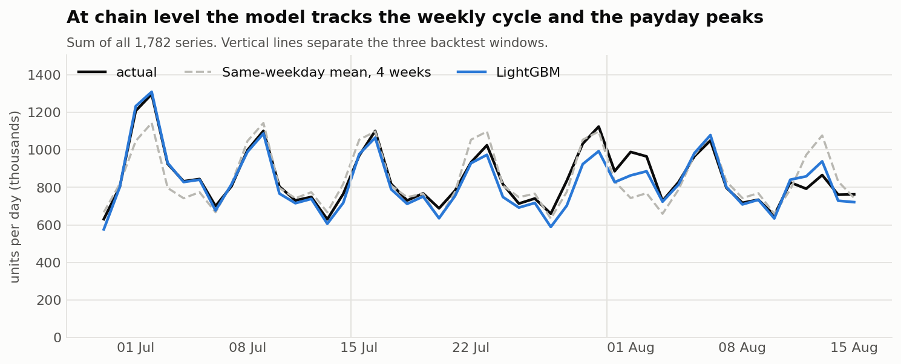
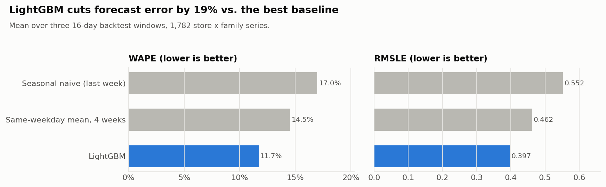
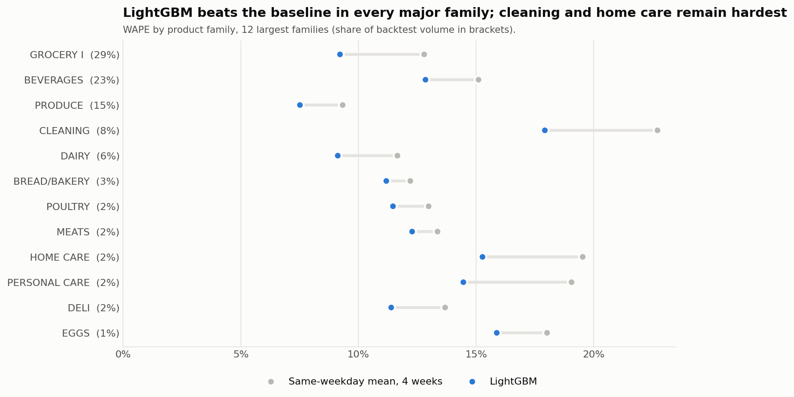
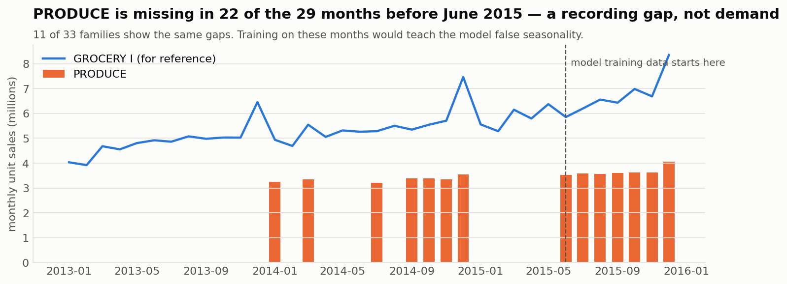
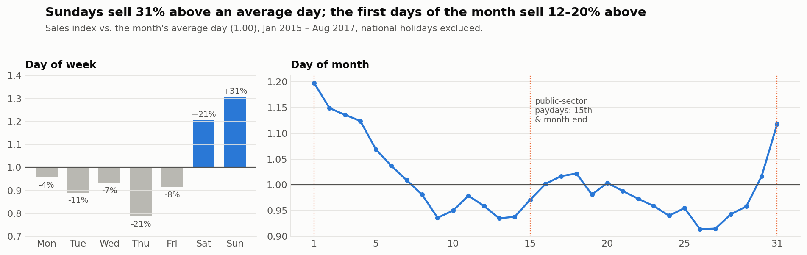

# Grocery Sales Forecasting

**16-day daily sales forecasts for 1,782 store × product-family series of a 54-store supermarket chain**
(Corporación Favorita, Ecuador), from SQL-based exploratory analysis to a backtested LightGBM model that
**cuts forecast error by 19%** versus the best spreadsheet-style baseline.

➡️ **[01 · Exploratory analysis](notebooks/01_eda.ipynb)** → **[02 · Forecasting](notebooks/02_forecasting.ipynb)**



## Results

Rolling-origin backtest over three consecutive 16-day windows (29 Jun – 15 Aug 2017); the model is re-trained at each
cutoff using only data available on that date.

| Model | WAPE | RMSLE | Bias |
|---|---|---|---|
| Seasonal naive (same weekday last week) | 17.0% | 0.552 | −3.1% |
| Same-weekday mean of last 4 weeks | 14.5% | 0.462 | −0.6% |
| **LightGBM (global model)** | **11.7%** | **0.397** | −2.8% |

- Wins in **all 3 backtest windows** and in **all 12 largest product families**.
- GROCERY I, BEVERAGES, PRODUCE (67% of volume): WAPE **7.5–12.8%**.
- Known weakness: slight under-forecast on **month-start payday peaks**. See the next steps in the notebook.

<table>
<tr>
<td></td>
<td></td>
</tr>
</table>

## What the EDA found (and what it changed in the model)

| Finding | Modelling decision |
|---|---|
| 11 of 33 families are **missing for long stretches before mid-2015** (e.g. PRODUCE absent in 22 of 29 months) | Train on 2015-06 onwards only |
| **Sunday +31%, Thursday −21%** vs. an average day; **1st of the month +20%** (public-sector paydays) | Day-of-week, day-of-month, days-to-month-end, payday flag |
| **Top 5 families = 79% of units**; 12 families have > 40% zero-sales days | Volume-weighted metric (WAPE) and zero forecasts for inactive series |
| Promotions lift **liquor (+66%) and beauty (+57%)**; dairy, deli, bakery < +3% | Promo count + promo intensity vs. the series' usual level |
| **Labour Day +57%**, 22–24 Dec +42–46% vs. the same weekday | National & local holiday flags, day-of-year |
| Oil price (Ecuador is an oil exporter): no meaningful correlation, and not known in advance | Tested and **not used** |

<table>
<tr>
<td></td>
<td></td>
</tr>
</table>

## Method

- **SQL first:** all EDA aggregation is in DuckDB SQL ([`sql/`](sql)), including window functions, `FILTER`
  aggregates, a same-weekday holiday baseline and a within-cell promo comparison.
- **One global LightGBM model** across all series on `log1p(sales)`.
- **Direct multi-horizon design:** every history feature is lagged by ≥ 16 days, so one model forecasts all 16 days
  with no leakage and no recursive error build-up ([`src/features.py`](src/features.py)).
- **Honest validation:** rolling-origin backtest, re-trained per cutoff, compared against simple baselines
  ([`src/forecast.py`](src/forecast.py)).

## Run it yourself

```bash
git clone https://github.com/mahirpasaa/grocery-sales-forecasting.git
cd grocery-sales-forecasting
python -m venv .venv && source .venv/bin/activate   # Windows: .venv\Scripts\activate
pip install -r requirements.txt
```

Download the data from the [Kaggle competition page](https://www.kaggle.com/competitions/store-sales-time-series-forecasting/data)
(accept the rules first) and put `train.csv`, `test.csv`, `stores.csv`, `oil.csv`, `holidays_events.csv` and
`transactions.csv` in `data/`. Then:

```bash
python src/prepare_data.py
jupyter notebook notebooks/
```

The forecasting notebook trains four models (three backtest folds + final). This takes about 3 minutes on a laptop.

## Project structure

```
├── data/                    # raw CSVs + parquet (git-ignored)
├── figures/                 # charts used in this README
├── notebooks/
│   ├── 01_eda.ipynb
│   └── 02_forecasting.ipynb
├── sql/                     # EDA queries (DuckDB)
└── src/
    ├── prepare_data.py      # CSV -> typed Parquet
    ├── features.py          # panel construction + feature engineering
    ├── forecast.py          # baselines, LightGBM, metrics, backtest
    ├── sql_runner.py
    └── style.py             # shared chart styling
```

## Data

*Store Sales – Time Series Forecasting* (Corporación Favorita), Kaggle. Used under the competition rules for
non-commercial analysis; the data is not redistributed in this repository.
